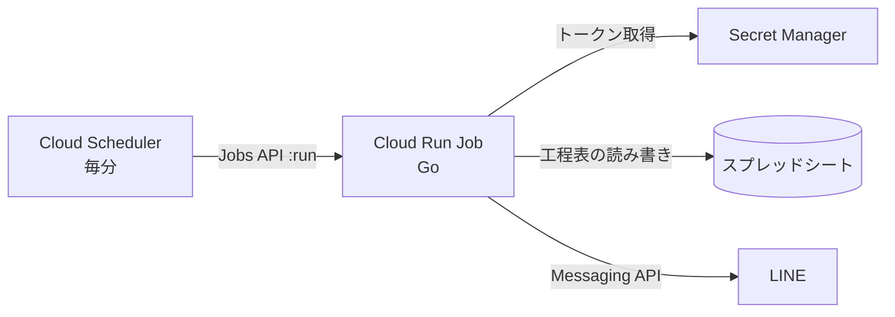

# 01. 概要

## 目的

ことならテックプロジェクトのイベント進行(工程表)に合わせて、LINE 公式アカウントからイベント参加者・関係者へ通知を送る。

## 前提

- イベント内の各プログラムは、スプレッドシートの**工程表(タイムテーブル)**に記録されている
- 通知は工程表の内容に従って送る。工程表が唯一の情報源(Single Source of Truth)
- エンドユーザーとの接点は **LINE のメッセージ送信画面のみ**(独自の Web/アプリ UI は持たない)
- 運用者は工程表(スプレッドシート)を編集するだけで通知内容が変わる

## 最重要要件

1. **Google の権限階層をそのまま利用する**(スプレッドシートの共有設定 = 誰が工程表を編集できるか)
2. **スプレッドシートをデータベースのインターフェースとして使う**(専用の管理画面・DB を作らない)
3. 通知タイミングの揺らぎを小さくする

## 技術方針

**GAS は使わない。** Cloud Scheduler + Cloud Run Job + Secret Manager + Sheets API で構成する。

Cloud Run は **Job** として使う。HTTP エンドポイントを持たず、起動されて処理し、終了する純粋なコンピュートとする。ビルドする Go バイナリは 1 つで、起動内容は環境変数で切り替える。

理由:
- GAS の時間主導型トリガーは実行時刻が揺らぐ
- GAS を「スプレッドシートの薄い API」にしても Sheets API の再実装にしかならず、認証経路・クォータ・デプロイが二重になる
- Sheets API を直接使えば、スプレッドシートの共有設定だけで権限管理でき、要件 1・2 を満たせる

### 構成要素

| 要素 | 役割 |
| --- | --- |
| Cloud Scheduler | 毎分、Cloud Run Job を起動する(Scheduler のジョブは 1 つ。無料枠内) |
| Cloud Run Job (Go, `backend/`) | 工程表を読み、開始間近のプログラムを判定し、LINE へ送信し、通知済みを工程表へ記録する |
| Secret Manager | LINE チャネルシークレット等の秘匿情報(アクセストークンは保管せず、アプリが実行のたびに発行する) |
| Sheets API | 工程表の読み書き |
| LINE Messaging API | メッセージ送信 |

エンドポイントを持たないため、API Gateway 相当のサービスも不要。

### 認証・権限

| 経路 | 方式 |
| --- | --- |
| Scheduler → Cloud Run Job | Scheduler 用サービスアカウントに、その Job への `roles/run.invoker` を付与し、Jobs API を OAuth で呼ぶ。公開エンドポイントは存在しない |
| Cloud Run → Sheets API | Cloud Run 実行用サービスアカウントで認証(鍵ファイルは使わない) |
| スプレッドシートの権限 | 上記実行用サービスアカウントのメールアドレスをスプレッドシートに共有する(通常は閲覧+通知済み記録のため編集者) |
| LINE のトークン | Secret Manager に保管し、Cloud Run Job 実行用サービスアカウントにだけ参照権限を付ける |

- サービスアカウントは用途ごとに分ける(Scheduler 用 / Job 実行用)。最小権限とする
- 工程表を編集できる人は、スプレッドシートの共有設定で管理する(Google の権限階層をそのまま利用)

## 開発方針: MVP を先に作る

### MVP

| 項目 | 内容 |
| --- | --- |
| 機能 | 工程表を読み、**現在時刻から n 分以内に始まるプログラム**を検出し、「まもなく開始します」旨の**固定文**を LINE の **broadcast(全友だちへ一斉配信)**で送信する |
| 起動 | Cloud Scheduler が毎分、Cloud Run Job を起動する(エンドポイントなし) |
| バイナリ | ビルドする Go バイナリは 1 つ。環境変数 `ROLE`(`scan` / 将来 `api`)で役割を切り替える。将来の API 追加にも同じコードベースで対応する |
| 判定 | 「ちょうど n 分前」ではなく「開始まで n 分以内で、未通知」で判定する。起動のずれや 1 回の取りこぼしを次回で吸収する |
| 重複防止 | 通知済みを工程表に記録し、同じプログラムへ二重送信しない(冪等にする) |

### MVP 以降(候補・未確定)

- Flex Message による通知(見た目は `docs/mocks/` で設計)
- LINE Webhook の受信(返信などの双方向機能)。broadcast ではユーザー ID の収集が不要なため、MVP では不要。受ける場合は別の受け口(HTTP サービス)を追加する前提で検討する
- 通知内容の差し込み(プログラム名・場所など)

## 関連ドキュメント

- [02-infra.md](02-infra.md) インフラ(Terraform・環境・認証・CD)
- [03-backend.md](03-backend.md) バックエンド(Go)の設計

## スコープ外(現時点)

- 独自の管理画面・Web UI
- スプレッドシート以外のデータベース
- LINE 上での双方向の対話機能

## 未決事項

[00-openquestion.md](00-openquestion.md) を参照。
