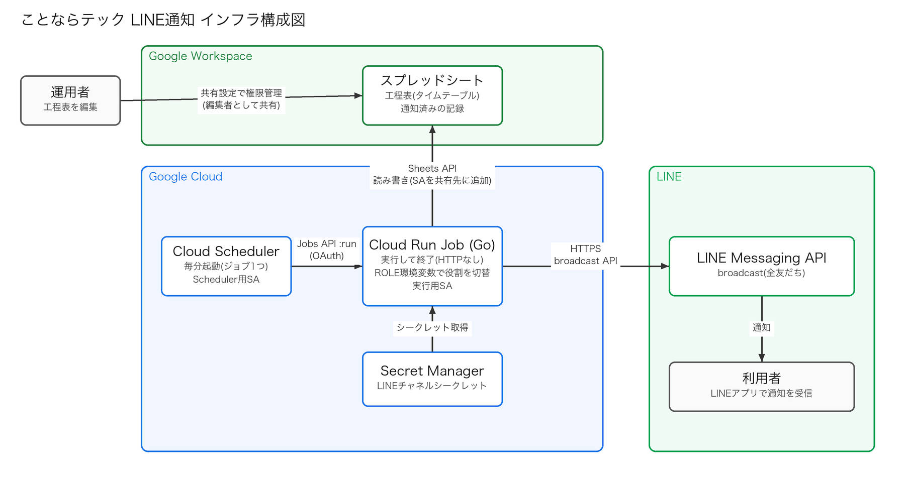

# 02. インフラ

構成図: [../infra/architecture.png](../infra/architecture.png)



インフラリソースはすべて Terraform で管理する(`infra/terraform/`)。デプロイは GitHub Actions から行う。

## 環境

GCP プロジェクトは **ops / dev / prod の 3 つ**に分ける(プロジェクトは AWS のアカウントに近い単位)。

| プロジェクト | 用途 | 置くもの | state の prefix |
| --- | --- | --- | --- |
| ops(`kototech-line-ops`) | 運用基盤 | Terraform state の GCS バケットのみ | (バケット自体は bootstrap の state) |
| dev(`kototech-line-dev`) | 開発・検証 | アプリのリソース一式(テスト用スプレッドシート / LINE チャネル) | `env/dev` |
| prod(`kototech-line-prod`) | 本番 | アプリのリソース一式 | `env/prod` |

- dev と prod は、リソース名・Workload Identity Pool が衝突しないよう、環境ごとにプロジェクトを分ける
- ops を分けるのは、dev / prod のどちらを消しても state が失われないようにするため
- VPC は使わない(すべてマネージドサービスの API 呼び出し)。プロジェクトの分割はネットワークの分離ではなく、リソース・IAM・クォータ・課金の分離
- スプレッドシート ID、LINE チャネル(チャネル ID・チャネルシークレット)は環境ごとに別のものを使う

## ディレクトリ構成

```
infra/terraform/
├── bootstrap/          # state 用 GCS バケット(最初に 1 回だけ実行)
├── env/
│   ├── dev/            # dev 環境のルートモジュール
│   └── prod/           # prod 環境のルートモジュール
└── modules/
    ├── apis/           # API の有効化
    ├── github_oidc/    # Workload Identity Federation(GitHub Actions 用)
    ├── artifact_registry/ # コンテナイメージのリポジトリ
    ├── secret_manager/ # Secret の入れ物
    ├── cloud_run_job/  # Cloud Run Job + 実行用サービスアカウント
    └── cloud_scheduler/# Scheduler ジョブ + Scheduler 用サービスアカウント
```

## Terraform state

- `bootstrap/` が **ops プロジェクト**に GCS バケットを作る(バージョニング有効、公開アクセス禁止、古い世代は新しい 10 世代を残して削除)
- `env/*` はこのバケットを backend に使う。prefix で環境を分ける(`env/dev`, `env/prod`)
- 別プロジェクトのバケットでも、IAM で許可すれば読み書きできる。`bootstrap/` の `state_admins` に、Terraform を実行する主体(人の Google アカウント、CI から実行する場合はデプロイ用サービスアカウント)を指定し、バケットへの `roles/storage.objectAdmin` を付与する
- 実行時のアプリ(Cloud Run Job など)は state を使わない
- `bootstrap/` 自身の state はローカル(コミットしない)
- バケット名はグローバルで一意。`bootstrap/variables.tf` と `env/*/backend.tf` の値を揃える(backend は変数を使えないため直書き)

### 初回セットアップ手順

1. ~~ops / dev / prod の GCP プロジェクトを作成し、共通の課金アカウントを紐付ける~~(済)
2. ~~`bootstrap/` で `terraform apply`(ops に state バケットを作成し、自分のアカウントに権限を付与)~~(済。バケット `kototech-line-notification-tfstate`、`asia-northeast1`)
3. `env/dev` で `terraform init` → `apply`(人が手元の権限で実行。OIDC ができるまで CI は使えない)
4. 出力された値(`workload_identity_provider`、`deployer_service_account`、`artifact_registry_repository_url`)を GitHub Actions に設定
5. LINE のチャネルシークレット(`line-channel-secret`)の**本物の値**を、環境ごとに別の version として登録する。アクセストークンは保管せず、アプリが `LINE_CHANNEL_ID`(Terraform の変数 `line_channel_id`)とシークレットから、実行のたびにステートレスなトークンを発行する。Terraform は Secret の入れ物と仮の version(`CHANGE_ME`)だけを作る(version が 0 件だと Cloud Run Job を作成できないため)。値は state に残さないよう Terraform 外から登録する(`printf %s "<値>" | gcloud secrets versions add line-channel-secret --data-file=- --project=<プロジェクト ID>`)。Cloud Run が環境変数として注入するため、アプリは Secret Manager の API を呼ばない
6. 出力された `runtime_service_account` のメールを、工程表スプレッドシートの共有先(編集者)に追加
   - デプロイ用サービスアカウントには、**共有しない**。インテグレーションテストは、デプロイ用アカウントが実行用アカウントを借りて(Terraform が dev のみ、`serviceAccountTokenCreator` を付与)、実行用アカウントとして読むため(D31)
7. 最初のデプロイ後、Environment の variable `SCHEDULER_PAUSED` を `false` にして、`deploy-to-*` を再実行する(Scheduler を有効化)
8. prod も同様に実施
9. GitHub Actions から Terraform を実行するため、dev / prod のデプロイ用サービスアカウント(`github-deployer@<プロジェクト ID>.iam.gserviceaccount.com`)を `bootstrap/` の `state_admins` に追加して再適用する(state バケットへの読み書き権限)

## モジュール

| モジュール | 作成するもの | 主な入力 |
| --- | --- | --- |
| `apis` | 必要な API の有効化 | `project_id` |
| `github_oidc` | Workload Identity Pool / GitHub Provider / デプロイ用サービスアカウント / 権限付与 | `github_repository`, `allowed_ref`, `deployer_roles` |
| `artifact_registry` | Docker リポジトリ(直近 10 世代を残す) | `name`, `keep_count` |
| `secret_manager` | Secret の入れ物と仮の version(本物の値は含まない) | `secret_ids` |
| `cloud_run_job` | Cloud Run Job / 実行用サービスアカウント / Secret 参照権限 | `name`, `env_vars`, `secret_env_vars`, `timeout`, `max_retries` |
| `cloud_scheduler` | Scheduler ジョブ / Scheduler 用サービスアカウント / Job の invoker 権限 | `job_name`, `job_location`, `schedule`, `paused` |

## 認証・権限

| 経路 | 方式 |
| --- | --- |
| GitHub Actions → GCP | Workload Identity Federation(鍵なし)。Provider の条件で対象リポジトリのみ許可。prod は `refs/heads/main` のみ許可。アプリのデプロイと **Terraform の実行**の両方に、同じデプロイ用サービスアカウントを使う |
| Scheduler → Cloud Run Job | Cloud Run Jobs API(`jobs/<name>:run`)を OAuth で呼ぶ。Scheduler 用サービスアカウントにだけ、その Job への `roles/run.invoker` を付与。Job には公開エンドポイントがない |
| Cloud Run → Sheets API | Cloud Run 実行用サービスアカウント。工程表スプレッドシートをこのメールに共有(Drive の共有のため Terraform 管理外) |
| Cloud Run → Secret Manager | 実行用サービスアカウントに、参照する Secret への `secretAccessor` のみ付与 |

サービスアカウントは用途ごとに分ける。

| サービスアカウント | 用途 |
| --- | --- |
| `github-deployer` | GitHub Actions のデプロイ |
| `line-notifier-scan-runtime` | Cloud Run Job の実行 |
| `line-notifier-scan-scheduler` | Scheduler から Job を起動する |

## Cloud Run Job

- HTTP エンドポイントを持たない。Scheduler に起動され、処理して終了する純粋なコンピュート
- イメージ(Go バイナリ)は 1 つ。役割は環境変数 `ROLE` で切り替える(`scan` の Job は `ROLE=scan`。[03-backend.md](03-backend.md))。役割を増やす場合は、同じイメージを使う Job を追加する
- 将来 API を追加する場合は、同じイメージを `ROLE=api` で動かす Cloud Run Service のモジュールを追加する
- タイムアウトは 300 秒、再試行は 0(毎分実行のため、次回の実行で拾う)。1 回の実行は 1 タスク
- イメージは Terraform では管理しない(`ignore_changes`)。初期値は placeholder で、GitHub Actions が更新する
- `deletion_protection` は prod のみ有効
- 起動時間(コンテナの立ち上げ)が毎回かかる。通知時刻のずれの許容は Q6 で判断する

## Cloud Scheduler

- 毎分(`* * * * *`、Asia/Tokyo)、Cloud Run Jobs API で `line-notifier-scan` を起動する
- 再試行しない(次の分の実行で拾う。重複は backend の冪等性で防ぐ)
- 前の実行が長引くと、次の実行と重なる。排他は backend 側で担保する(Q11)
- 初回デプロイ前は、Job のイメージが placeholder のため、`scheduler_paused = true`(既定)で一時停止しておき、最初のデプロイ後に Environment の variable `SCHEDULER_PAUSED` を `false` にして再デプロイする
- ジョブは環境ごとに 1 つ。課金アカウントは全環境で共通(D19)で、Scheduler の無料枠(3 ジョブ/課金アカウント)は dev と prod で合算されるが、現状は 2 ジョブなので収まる。ジョブを増やす場合は残り 1 つになる点に注意

## CD(GitHub Actions)

ワークフローは `.github/workflows/` に置く(GitHub の仕様で、reusable workflow は `.github/actions/` ではなくここに置く必要がある)。

| ファイル | 役割 | トリガー |
| --- | --- | --- |
| `ci.yml` | QA のみ(`make verify` と同じ範囲) | PR の作成・コミットの追加・開き直し(毎回)、手動 |
| `reusable-qa.yml` | backend の `make test` / `make lint` / `make build`、Terraform の `fmt` / `validate`、ドキュメントと yml の検査(`scripts/verify.mjs`) | 他から呼び出し |
| `reusable-integration-test.yml` | インテグレーションテスト(`make integration-test`)。**実行用サービスアカウントを借りて**、実際の工程表を読めることを確認する(読み取りのみ) | 他から呼び出し |
| `reusable-infra-deploy.yml` | Terraform の `init` → `validate` → `plan` → `apply`(`apply: false` で plan のみ) | 他から呼び出し |
| `reusable-deploy-backend.yml` | イメージのビルド → Artifact Registry へ push → Cloud Run Job のイメージ更新 | 他から呼び出し |
| `deploy-to-dev.yml` | QA → インフラ(Terraform)→ **インテグレーションテスト** → アプリのデプロイ | `develop` への push、手動(任意のブランチ) |
| `deploy-to-prod.yml` | QA → インフラ(Terraform)→ アプリのデプロイ | `main` への push、手動。`main` 以外は拒否 |
| `apply-to-dev.yml` | **インフラ(Terraform)だけ**を適用する。QA とアプリのデプロイはしない。`apply` を false にすると plan だけ | 手動のみ(任意のブランチ) |
| `apply-to-prod.yml` | 同上(prod)。`main` 以外は拒否。Environment `prod` の承認あり | 手動のみ |

- ブランチ運用は [../operations/01-operations.md](../operations/01-operations.md) を参照
- 認証は Workload Identity Federation(鍵なし)。prod は、Provider の条件でも `refs/heads/main` 以外を拒否する
- 接続情報は、GitHub の **Environment**(`dev` / `prod`)の variables から読む。値は Terraform の出力

| Environment variable | 値の出どころ |
| --- | --- |
| `WORKLOAD_IDENTITY_PROVIDER` | 出力 `workload_identity_provider` |
| `DEPLOYER_SERVICE_ACCOUNT` | 出力 `deployer_service_account` |
| `RUNTIME_SERVICE_ACCOUNT` | 出力 `runtime_service_account`(**dev のみ**。インテグレーションテストが借りるサービスアカウント) |
| `ARTIFACT_REGISTRY_REPOSITORY_URL` | 出力 `artifact_registry_repository_url` |
| `CLOUD_RUN_JOB_NAME` | 出力 `cloud_run_job_scan` |
| `GCP_PROJECT_ID` | その環境の GCP プロジェクト ID(Terraform の `project_id`) |
| `REGION` | `asia-northeast1` など(未設定なら `asia-northeast1`) |
| `LINE_CHANNEL_ID` | その環境で使う LINE チャネルの ID(Terraform の `line_channel_id`) |
| `SPREADSHEET_ID` | その環境の工程表のスプレッドシート ID(Terraform の `spreadsheet_id`。dev ではインテグレーションテストも読む) |
| `NOTIFY_LEAD_MINUTES` | 開始の何分前から通知するか(1〜1440)。任意で、未設定なら `10`(Terraform の `notify_lead_minutes` → Job の環境変数 `NOTIFY_LEAD_MINUTES`) |
| `SCHEDULER_PAUSED` | Scheduler を一時停止するか。未設定なら `true`。最初のデプロイ後に `false` にする |
| `APP_ENV` | インテグレーションテスト用(dev のみ) |

- Environment `prod` に Required reviewers を設定し、デプロイ前に承認を挟む
- イメージは `<リポジトリ URL>/notifier:<コミット SHA>` でタグ付けする。Job の環境変数・Secret は Terraform の管理で、CD はイメージだけを更新する
- Terraform は GitHub Actions から実行する(D22)。`reusable-infra-deploy.yml` が `plan` の結果を保存し、**そのプランをそのまま `apply`** する。`plan` の内容はジョブのサマリに出力される
- Terraform の変数(`project_id` など)は、tfvars をコミットしないため、Environment の variables を `TF_VAR_*` として渡す
- `deploy-to-*` の順序は **QA → インフラ → アプリのデプロイ**。Cloud Run Job や Artifact Registry を Terraform が先に作ってから、イメージを更新する
- Environment `prod` の承認は、ジョブごとに求められるため、prod では「インフラ」と「アプリのデプロイ」で 2 回承認する。承認前に `plan` を確認する形に分けたい場合は、承認を挟まない plan 専用の Environment を別に用意する方法がある(未実施)
- PR 上での `plan` は未実装(`ci.yml` には含めていない)。`reusable-infra-deploy.yml` の `apply: false` で追加できる

## デプロイ用サービスアカウントの権限

GitHub Actions 用の `github-deployer` には、プロジェクトレベルで次のロールを付与する(`modules/github_oidc` の変数 `deployer_roles` / `terraform_roles`)。

| 用途 | ロール |
| --- | --- |
| アプリのデプロイ | `roles/run.admin`、`roles/artifactregistry.writer`、`roles/iam.serviceAccountUser` |
| Terraform: API の有効化 | `roles/serviceusage.serviceUsageAdmin` |
| Terraform: Workload Identity | `roles/iam.workloadIdentityPoolAdmin` |
| Terraform: サービスアカウント | `roles/iam.serviceAccountAdmin` |
| Terraform: プロジェクトの IAM | `roles/resourcemanager.projectIamAdmin` |
| Terraform: Artifact Registry | `roles/artifactregistry.admin` |
| Terraform: Secret Manager | `roles/secretmanager.admin` |
| Terraform: Cloud Scheduler | `roles/cloudscheduler.admin` |
| state バケット(ops プロジェクト) | `roles/storage.objectAdmin`(`bootstrap/` の `state_admins` で付与) |

注意:

- `projectIamAdmin` や `serviceAccountAdmin` を持つため、**実質的にプロジェクトの管理者権限**になる。dev は任意のブランチから手動デプロイできるが、prod は Provider の条件で `refs/heads/main` に限定し、Environment `prod` の承認を挟む
- `secretmanager.admin` は Secret の値を読む権限(`versions.access`)も含む。値を読めない専用のカスタムロールに絞る案は、必要になったら検討する
- prod の Workload Identity は `refs/heads/main` のみ許可するため、**PR 上では prod の `terraform plan` は実行できない**(dev は可能)。prod の plan / apply は `main` への push 後に行う
- `terraform apply` で Workload Identity Pool・サービスアカウント・IAM 自体を変更すると、実行中の認証を壊す恐れがある。変更時は plan の差分を必ず確認する

## 未実施・未決

- Terraform は `validate` まで確認済みで、`plan` / `apply` は未実行
- PR 上での `terraform plan`(prod は Workload Identity の条件で不可。dev のみ可能)
- 通知失敗のアラート(Cloud Monitoring)
- 詳細は [00-openquestion.md](00-openquestion.md)

## LINE チャネルシークレットの再発行(手作業)

アクセストークンは自動で発行されるため、人が行う更新作業はない。チャネルシークレットを再発行する(漏洩の疑いなど)ときだけ、次の手順を踏む。

1. LINE Developers コンソールで、対象環境のチャネルシークレットを再発行する(古い値はすぐに使えなくなる可能性がある)
2. すぐに、新しい値を Secret Manager に新しい version として追加する
3. 次の Job の実行から、`latest` の新しい値が使われる(再デプロイは不要)
4. 切り替えの間に Job が失敗しても、次の分の実行で復旧する(失敗は終了コード 1 で記録される)
