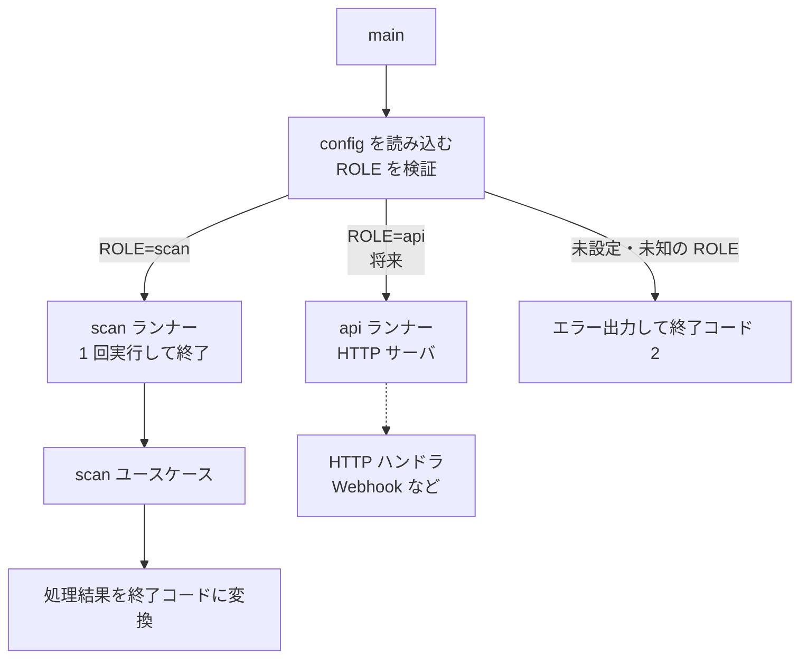
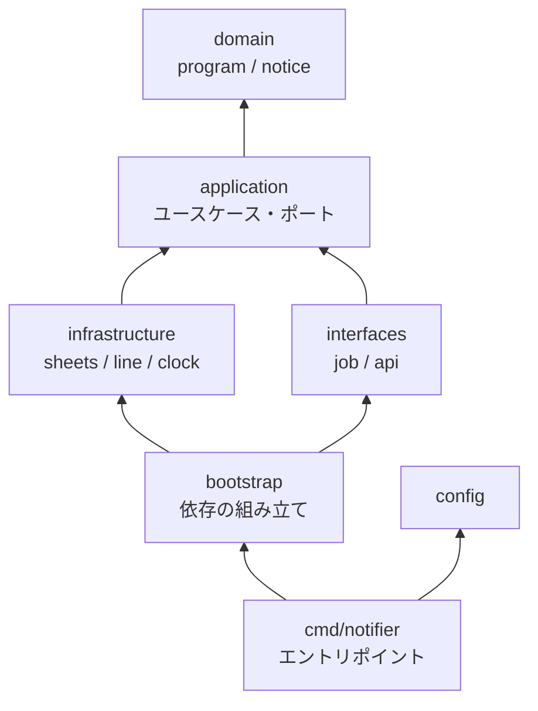
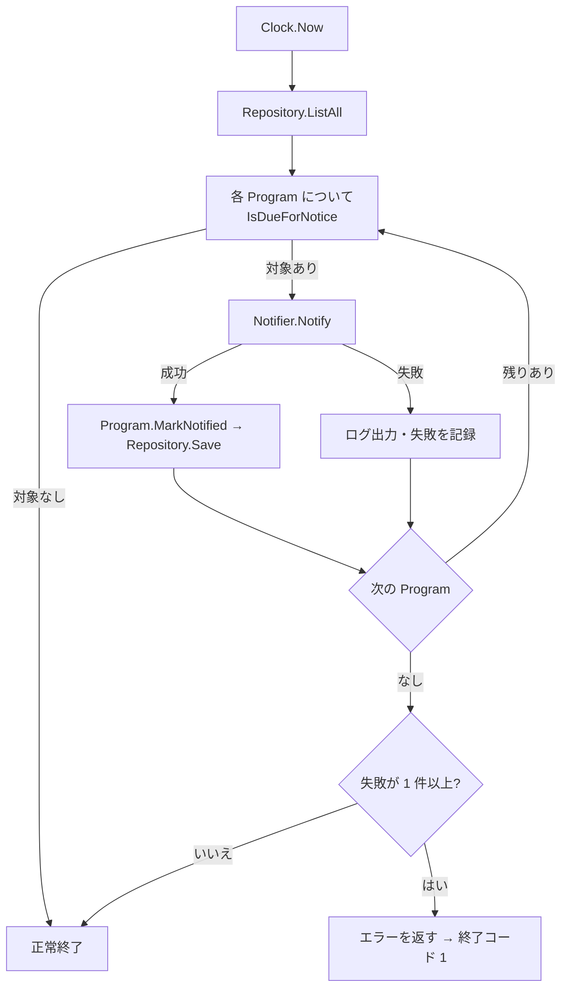

# 03. バックエンド

`backend/` に置く Go のアプリケーション。基本は **DDD(ドメイン駆動設計)の構成**で開発する。

MVP は「起動して処理し、終了する」Cloud Run Job として動かす。将来、同じコードベースに API(HTTP)を追加する可能性があるため、**エントリポイントで環境変数 `ROLE` によりプロセスの役割を切り替える**(Job でも `ROLE` を使う)。

インフラ側の構成は [02-infra.md](02-infra.md) を参照。

## 方針

- ビルドする Go バイナリ(コンテナイメージ)は **1 つだけ**(D13)
- 起動時の環境変数 `ROLE` でやることを切り替える。役割ごとにバイナリやイメージを分けない
- ビジネスルール(いつ・何を通知するか)は **ドメイン層に閉じ込め**、Sheets / LINE などの外部サービスの事情をドメインに持ち込まない
- 工程表の列の形式は [04-timetable-sheet.md](04-timetable-sheet.md) を正本とし、読み取りは infrastructure 層に閉じ込める(形式が変わってもドメインとユースケースは変えない)

## 責務(MVP)

1. 工程表(スプレッドシート)を Sheets API で読む
2. 現在時刻から n 分以内に始まる、未通知のプログラムを判定する
3. LINE Messaging API で通知を送る
4. 通知済みを工程表に記録する

通知ロジックはすべてここに置く。GAS は使わない。

## 起動方式

### 環境変数

| 環境変数 | 内容 | 必須 | 由来 |
| --- | --- | --- | --- |
| `ROLE` | **このプロセスの役割**。`scan`(MVP)/ `api`(将来) | 常に必須 | Terraform(平文) |
| `APP_ENV` | `dev` / `prod`(ローカル実行は `local`) | 常に必須 | Terraform(平文) |
| `SPREADSHEET_ID` | 工程表のスプレッドシート ID | `ROLE=scan` のとき必須 | Terraform(平文) |
| `SHEET_NAME` | 工程表のシート名 | 任意(既定 `工程表`) | - |
| `NOTIFY_LEAD_MINUTES` | 開始の何分前から通知するか(1〜1440) | 任意(既定 10) | Terraform(平文) |
| `LINE_CHANNEL_ID` | LINE チャネル ID(ステートレスなアクセストークンの発行に使う。秘匿情報ではない) | LINE へ送信する ROLE で必須 | Terraform(平文) |
| `LINE_CHANNEL_SECRET` | LINE チャネルシークレット(アクセストークンの発行と、Webhook の署名検証に使う) | LINE へ送信する ROLE で必須 | Secret Manager |
| `PORT` | 待ち受けポート | `ROLE=api` のとき | Cloud Run が設定 |

- 切り替えの環境変数は **`ROLE` に一本化**する。Job でも `ROLE` を使い、`TASK` のような別の切り替え変数は持たない

### 秘匿情報の扱い

- `LINE_CHANNEL_SECRET` などの秘匿情報は **Secret Manager に保管し、Cloud Run が環境変数として注入**する(Terraform の `secret_env_vars`)
- アプリは Secret Manager の API を呼ばない。環境変数を読むだけにする(SDK 依存と権限が増えない)
- 注入するのは、その Job / サービスが実際に使う Secret だけにする(最小権限)
- **チャネルアクセストークンは保管しない**。アプリが実行のたびに発行する(次節)
- 秘匿情報はログに出さない。config では専用の型(`String()` / JSON 出力をマスクする)で保持する
- 必須の環境変数が欠けていれば、起動時に終了コード 2 で止める(トークンの発行を試みない)

### LINE の認証(アクセストークンの自動発行)

LINE のアクセストークンは、**ステートレスなチャネルアクセストークン**(有効期間 約 15 分)を使う。人が発行・更新・ローテーションするトークンを持たない(手作業のミスを避ける)。

- 発行: `POST https://api.line.me/oauth2/v3/token`(`grant_type=client_credentials`、`client_id` = チャネル ID、`client_secret` = チャネルシークレット)。レスポンスの `access_token` と `expires_in` を使う(仕様は公式で確認する)
- **ミドルウェアとして実装する**: `infrastructure/line` の中で、`http.RoundTripper` を包む認証用トランスポートが、リクエストのたびに有効なトークンを `Authorization: Bearer` に付ける。呼び出し側(`Notifier`、ユースケース、ドメイン)は、トークンの存在を意識しない
  - トークンはプロセスのメモリにだけ保持する。有効期限の少し前(余裕を持たせる)になったら、自動で再発行する
  - 並行して呼ばれても、発行は 1 回にまとめる(排他する)
  - `401` が返ったら、トークンを破棄して **1 回だけ**再発行して再試行する(それでも失敗すれば、エラーとして返す)
- Job は短時間で終了するので、通常は実行ごとに 1 回の発行で済む
- 発行に失敗した場合は、送信せずに終了コード 1 で終わる(次の分の実行で再試行される)
- 発行したトークンは、ログに出さない

**自動化できないもの**: チャネルシークレット(長期の認証情報)は、LINE 側に再発行の API がなく、コンソールでの手作業になる。漏洩時などに限られ、頻度は低い。手順は `02-infra.md` に残し、再発行したらすぐに Secret Manager に新しい version を追加する(`latest` を読むため、アプリの再デプロイは不要)。

### ROLE による切り替え



| ROLE | 動作 | 実行基盤 | 状態 |
| --- | --- | --- | --- |
| `scan` | 工程表を読み、開始間近のプログラムを通知して終了する(1 回実行) | Cloud Run Job(Scheduler が起動) | MVP |
| `api` | HTTP サーバとして `PORT` で待ち受ける | Cloud Run Service(将来、Terraform にモジュールを追加) | 未実装。`ROLE=api` で起動した場合は「未実装」のエラーで終了コード 2 |

- `ROLE` は**必須**。未設定でも既定値で動かさず、エラーにする(設定ミスで想定外の動作をすることを防ぐ)
- 各 ROLE は、共通の `Runner`(`Run(ctx) error`)として登録し、`main` は `ROLE` に対応する Runner を呼ぶだけにする
- 役割を増やすときは、`ROLE` の値・Runner・(必要なら)ユースケースを追加する。Job なら同じイメージを使う Job を Terraform に足し、API なら Cloud Run Service のモジュールを足す
- 必須の環境変数は `ROLE` ごとに検証する。足りなければ、起動時に**一括で**エラーを出して終了する
- `ROLE=scan` ではポート待ち受け・ヘルスチェック・Webhook 受信は持たない

### 終了コード

| コード | 意味 |
| --- | --- |
| 0 | 正常終了 |
| 1 | 処理の失敗(送信失敗、外部 API エラーなど) |
| 2 | 設定エラー(`ROLE` が未設定・未知、必須の環境変数の欠落) |

Cloud Run Job は終了コードで成否を判定する。

## レイヤー構成(DDD)



| 層 | 責務 | 依存してよいもの |
| --- | --- | --- |
| `domain` | ビジネスルール。エンティティ・値オブジェクト・ドメインサービス・リポジトリのインターフェース | 標準ライブラリのみ(外部ライブラリ・他の層に依存しない) |
| `application` | ユースケースの手順。外部サービスのポート(インターフェース)を定義して呼び出す | `domain` |
| `infrastructure` | ポート・リポジトリの実装(Sheets、LINE、時計)。外部 API の事情はここで吸収する | `domain` / `application` |
| `interfaces` | 入口のアダプタ。`job`(ROLE ごとのバッチ Runner)、将来の `api`(HTTP ハンドラ) | `application` |
| `bootstrap` | 依存の組み立て(Composition Root)。具体実装を選んでユースケースに注入する | すべて |
| `config` | 環境変数の読み込みと検証 | 標準ライブラリのみ |

- **依存は内側(domain)に向かう一方向**。`domain` は他の層を import しない
- 依存方向の違反は、`golangci-lint` の `depguard` で検出する(`backend/.golangci.yml` に設定済み)。`domain` は標準ライブラリと自分自身だけ、`application` は標準ライブラリと `domain` と自分自身だけを許可する許可リスト方式で、外部ライブラリや外側の層は、列挙しなくてもすべて拒否される
- 境界づけられたコンテキストは MVP では 1 つ(通知)。CQRS・イベントソーシングなどは導入しない(必要になるまで足さない)

### ユビキタス言語

| 日本語 | コード | 説明 |
| --- | --- | --- |
| 工程表 / タイムテーブル | (`ProgramRepository` の実体) | スプレッドシート。ドメインには「工程表」という概念を出さず、プログラムの集まりとして扱う |
| プログラム | `Program` | イベント内の 1 つの進行単位。**集約ルート** |
| 開始時刻 | `StartAt` | プログラムの開始日時(`time.Time`、JST で解釈) |
| 通知済み | `NotifiedAt` | 通知した日時。空なら未通知 |
| リードタイム(n 分) | `LeadTime` | 開始の何分前から通知するか |
| 開始間近通知 | `notice.StartingSoon` | 「まもなく開始します」を伝える通知(MVP は固定文) |

### ドメイン層

```go
// domain/program

type ID string

type Program struct {
    id            ID
    eventName     string
    name          string
    location      string
    startAt       time.Time
    notifyEnabled bool
    notifiedAt    *time.Time
}

// 通知対象か。開始まで leadTime 以内で、開始前で、未通知。
func (p *Program) IsDueForNotice(now time.Time, lead LeadTime) bool

// 通知済みにする。すでに通知済みならエラー(冪等性をドメインで守る)
func (p *Program) MarkNotified(at time.Time) error

// リポジトリ(インターフェースのみ。実装は infrastructure)
type Repository interface {
    ListAll(ctx context.Context) ([]*Program, error)
    Save(ctx context.Context, p *Program) error // 通知済みの記録など
}
```

- 「開始まで n 分以内かつ未通知」「開始済みは対象外」(D6)は `IsDueForNotice` に置く。**時刻は引数で受け取り、`time.Now()` を直接呼ばない**
- `domain/notice` は、プログラムから通知内容を作る値オブジェクト(MVP は固定文。Flex Message 化は `docs/mocks/` で設計してから拡張)
- フィールドは、工程表の列([04-timetable-sheet.md](04-timetable-sheet.md))に対応する: イベント名・プログラム名・場所・開始日時・通知するか・通知済みの日時

### アプリケーション層

```go
// application/port
type Notifier interface {
    Notify(ctx context.Context, n notice.Notice) error
}
type Clock interface {
    Now() time.Time
}

// application/scan
type UseCase struct {
    Programs program.Repository
    Notifier port.Notifier
    Clock    port.Clock
    Lead     program.LeadTime
    Logger   *slog.Logger
}

func (u *UseCase) Execute(ctx context.Context) error
```

`scan.UseCase.Execute` の手順:



- **1 件の失敗で全体を止めない**。他のプログラムの通知は続行し、最後に失敗があればエラーを返す(終了コード 1)
- **冪等にする**: 通知済みの記録を信頼の源とし、同じプログラムへ二重送信しない。Job の実行が重なる場合の排他は Q11 で決める
- **読み取りは 1 回にまとめる**: `ListAll` で工程表全体を 1 回で読む(Sheets API の割り当て節約)
- 送信と記録の順序は「送信 → 記録」。記録に失敗しても、次回の実行で同じ Retry Key(プログラム ID から決まる UUID)で送るため、LINE 側で重複として扱われ(409)、二重配信にはならない。409 は成功として扱い、通知済みを記録し直す
- 1 回の実行は短時間で終わらせる(Job のタイムアウトは 300 秒、再試行なし)

### インフラストラクチャ層

| パッケージ | 実装するもの | 使うもの | 認証 |
| --- | --- | --- | --- |
| `infrastructure/sheets` | `program.Repository` | `google.golang.org/api/sheets/v4` | Application Default Credentials(実行用サービスアカウント) |
| `infrastructure/line` | `port.Notifier`(LINE の **broadcast** で全友だちへ送る)と、トークン自動発行の認証トランスポート | 標準 `net/http`(`POST /v2/bot/message/broadcast`、`POST /oauth2/v3/token`。公式 SDK は使わない: D30) | `LINE_CHANNEL_ID` + `LINE_CHANNEL_SECRET`(ステートレスなトークンを発行) |
| `infrastructure/clock` | `port.Clock` | 標準ライブラリ | - |

- **送信は broadcast のみ**。送信先(ユーザー ID・グループ ID)をドメインに持たない。`Notifier` は「通知内容」だけを受け取る
- **二重送信の防止にリトライキーを使う**: LINE の broadcast には、同じ `X-Line-Retry-Key`(UUID)のリクエストを重複して配信しない仕組みがある。`notice.Notice` に、プログラム ID と通知の種類から決まる安定したキー(UUID v5 など)を持たせ、送信時に付与する。通知済みの記録(工程表)に加えた、二重の防止策になる(有効期間などの仕様は公式を確認する。Q11)
- **工程表のカラム構成との対応(行 ⇔ `Program`)は `infrastructure/sheets` に閉じ込める**(防腐層)。シートのレイアウトが変わっても、ドメインは変わらない
- 時刻は JST(`Asia/Tokyo`)で解釈する。コンテナにタイムゾーンデータがなくても動くよう、`time/tzdata` を import して埋め込む
- ローカル開発では、`gcloud auth application-default login` またはサービスアカウントの偽装を使う(鍵ファイルは作らない)

### インターフェース層

| パッケージ | 内容 | 状態 |
| --- | --- | --- |
| `interfaces/job` | `ROLE=scan` の Runner(ユースケースを 1 回実行して結果を返す) | MVP |
| `interfaces/api` | `ROLE=api` の Runner と HTTP ハンドラ(Webhook 受信、署名検証)。同じ `application` 層を呼ぶ | 未作成(予約) |

- ハンドラ・ランナーにビジネスロジックは書かない。入力を `application` の呼び出しに変換するだけにする
- `api` を足す場合も、`domain` / `application` は変更せず、入口のアダプタと Terraform(Cloud Run Service モジュール)を追加するだけで済むようにする

## ディレクトリ構成

```
backend/
├── cmd/notifier/
│   └── main.go                 # エントリポイント。config 読込 → ROLE の Runner を実行 → 終了コード
├── internal/
│   ├── config/                 # 環境変数の読み込み・検証(ROLE ごとの必須項目)
│   ├── bootstrap/              # 依存の組み立て(Composition Root)
│   ├── domain/
│   │   ├── program/            # Program 集約、LeadTime、Repository インターフェース
│   │   └── notice/             # 通知内容の値オブジェクト
│   ├── application/
│   │   ├── port/               # Notifier、Clock などのポート
│   │   └── scan/               # scan ユースケース
│   ├── infrastructure/
│   │   ├── sheets/             # Program リポジトリの実装
│   │   ├── line/               # Notifier の実装
│   │   └── clock/              # Clock の実装
│   └── interfaces/
│       ├── job/                # ROLE=scan の Runner
│       └── api/                # (将来)HTTP ハンドラ
├── Dockerfile
├── Makefile
└── go.mod
```

- すべて `internal/` 配下に置き、外部から import されないようにする(公開する API を持たないため)
- コンテナイメージは、静的ビルドしたバイナリのみを含む最小のイメージにする(`CGO_ENABLED=0`)

## テスト

| 対象 | 方法 |
| --- | --- |
| `domain` | 外部に依存しない純粋な単体テスト(時刻を固定。境界値、開始済み、通知済み、日付またぎ) |
| `application` | `Repository` / `Notifier` / `Clock` のフェイクで検証(1 件の失敗で全体が止まらないこと、二重送信しないこと) |
| `config` | `ROLE` の未設定・未知、`ROLE` ごとの必須項目の欠落が終了コード 2 になること |
| `infrastructure` | 実 API を使うインテグレーションテスト(`//go:build integration`)。dev 環境のみ |

- 開発コマンドは下記の `make` を使う。CI でも同じコマンドを使う

## 開発コマンド

`backend/Makefile`(ルートの `Makefile` からも同名で呼べる)。

| コマンド | 内容 |
| --- | --- |
| `make test` | ユニットテスト(`-race -cover`)。外部 API は叩かない |
| `make lint` | `go vet` + `golangci-lint` |
| `make integration-test` | `-tags=integration` のテスト。dev 環境の実 API を使う(ADC と環境変数が必要。prod に対しては実行しない) |
| `make build` | `bin/notifier` を 1 つビルド(`CGO_ENABLED=0`、`GOOS` / `GOARCH` で上書き可) |

- ローカル実行は `ROLE=scan APP_ENV=dev SPREADSHEET_ID=... LINE_CHANNEL_ID=... LINE_CHANNEL_SECRET=... go run ./cmd/notifier` のように環境変数で切り替える

## ログ・エラー

- 構造化ログ(JSON、`log/slog`)を標準出力へ。Cloud Logging に集約される。slog の既定のキー(`level` / `msg`)は Cloud Logging に認識されないため、`severity`(`ERROR` / `WARNING` / `INFO` / `DEBUG`)と `message` に置き換えて出力する(エラーだけを絞り込めるようにするため)
- すべてのログに `role`、`app_env` を付ける
- 失敗は非 0 終了で Job の失敗として記録される。アラート方法は未決(Q7、Q17)

## 未決

[00-openquestion.md](00-openquestion.md) の Q6〜Q9、Q11、Q14、Q17、Q19 に依存する。
