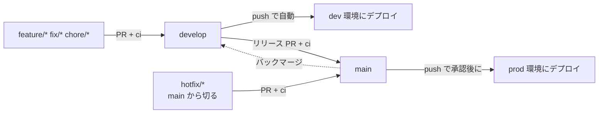

# 01. GitHub の利用フロー

## ブランチ

| ブランチ | 役割 | 保護 | デプロイ先 |
| --- | --- | --- | --- |
| `main` | **本番(prod)の写し**。main の内容 = prod にデプロイされているもの | あり(下記) | prod |
| `develop` | 開発の統合ブランチ。作業の起点 | あり(Ruleset `develop-squash-only`。PR 必須・スカッシュのみ・削除と force push の禁止) | dev |
| `feature/*` など | 個別の作業ブランチ。`develop` から切る | なし | なし(手動で dev へデプロイ可) |

- 基本は **`develop` を起点に作業ブランチを切り、PR を `develop` へマージ**する
- `develop` への変更は、必ず PR 経由(直 push は、Ruleset で止まる)
- 本番へ出すときは、`develop` → `main` の PR を作ってマージする
- 現在は**フェーズ 2 に移行済み**(次の「運用フェーズ」を参照)

## 運用フェーズ

ブランチ保護は**最後(開発が安定してから)に掛ける**予定だったが、マージ方法を、ブランチごとに固定するため、**フェーズ 2 に移行した**(D33)。Ruleset でマージ方法を指定するには、PR 必須(直 push の禁止)を同時に有効にする必要がある。

**現在の状態**: PR 必須とマージ方法の固定(下記)は設定済み。**必須ステータスチェック・承認(他の人の Approve)は、まだ設定していない**(Approve できるメンバーが揃ってから)。

| | フェーズ 1: 開発初期 | フェーズ 2: 安定後 |
| --- | --- | --- |
| `develop` への変更 | **直 push 可** | PR 経由のみ(Ruleset で強制。**スカッシュマージのみ**) |
| `main` の保護 | 掛けない | **掛ける**(下記「ブランチ保護」。**マージコミットのみ**) |
| `main` への変更 | `develop` からのマージのみ(運用ルール) | `develop` → `main` の PR のみ。**他の人の Approve が必須** |
| レビュー | 不要 | 他の人が Approve する |
| CI | push 時に QA が走る(`deploy-to-dev`) | 同左 + PR で `ci` が必須 |

- フェーズ 2 への移行は、プロトタイプの機能が揃い、dev で安定して動くことを目安に判断する(移行時に保護を設定する)
- フェーズ 1 でも、`main` にマージされると prod へのデプロイ(承認待ち)が起動する。prod への反映は Environment `prod` の承認で止められる



## 作業ブランチ

名前は、**種類と Issue 番号から始める**: `<種類>/<Issue番号>-<短い説明>`(説明は、英小文字のケバブケース)。

| 種類 | 用途 | 切る元 |
| --- | --- | --- |
| `feature/` | 機能追加 | `develop` |
| `fix/` | 不具合修正 | `develop` |
| `chore/` | 設定・依存・ドキュメントなど | `develop` |
| `hotfix/` | 本番の緊急修正 | `main` |

- 例: `feature/12-scan-task`、`fix/15-jst-boundary`、`chore/2-title-prefix`
- **作業は、必ず Issue から始める**。Issue がなければ、先に立てる(Issue がないと、ブランチ名を決められない)
- 作業ブランチは、マージ後に削除する(自動削除は有効にしていない。リリース PR の `develop` を、消さないため)

## Git の設定と force push

### 必須の git config

開発を始める前に、**全員が**次の 2 つを設定する。`--global` なので、マシンごとに 1 回でよい。

```
git config --global merge.ff false
git config --global pull.ff only
```

| 設定 | 動き | 目的 |
| --- | --- | --- |
| `merge.ff false` | `git merge` で、fast-forward できる場合も、常にマージコミットを作る | ブランチの合流を、マージコミットとして履歴に残す。設定が人によって違うと、同じ操作でも履歴の形が変わる |
| `pull.ff only` | `git pull` は、fast-forward できる場合だけ許可する(`git pull` では `merge.ff` より優先される) | 意図しないマージコミットやリベースを防ぐ |

- `--global` の設定は、このマシンの**すべてのリポジトリ**に効く。他のリポジトリでも、分岐した `git pull` は止まり、`git merge` は常にマージコミットを作る
- 分岐していて fast-forward できないとき、`git pull` は `fatal: Not possible to fast-forward, aborting.` で止まる。`git merge` か `git rebase` を、自分で選んで実行する。止まるのは取得のあとなので、`origin/<作業ブランチ名>` は更新されている(次の「force push」を参照)
- 設定済みかは `git config --global --get-all merge.ff` と `git config --global --get-all pull.ff` で確かめる(それぞれ `false`・`only` が 1 行だけ出れば正しい)
- `--add` 付き(`git config --global --add merge.ff false`)でも同じ値になるが、再実行すると**同じ値が重複して**追加される。重複していると、`--add` なしは `error: cannot overwrite multiple values with a single value` で失敗する。`git config --global --replace-all merge.ff false` で 1 つにまとめる(`pull.ff` も同様)

### force push

force push するのは、**自分の作業ブランチ**だけ。`develop` と `main` は、Ruleset で force push を禁止している(「ブランチ保護」)ので、押せない。

作業ブランチには保護がないため、`--force` だと、他の人が push したコミットまで上書きしてしまう(`--force` は、下の確認を何もせずに上書きする)。そのため、**いつも `--force-with-lease --force-if-includes` を使う**。

```
git push --force-with-lease --force-if-includes origin <作業ブランチ名>
```

| オプション | 拒否する条件 |
| --- | --- |
| `--force-with-lease` | リモートの作業ブランチが、手元の `origin/<作業ブランチ名>`(最後に取得した状態)と違うとき(`(stale info)` で拒否される) |
| `--force-if-includes`(Git 2.30 以降) | 手元の `origin/<作業ブランチ名>` の先頭が、手元の作業ブランチに取り込まれていないとき(`Updates were rejected because the tip of the remote-tracking branch has been updated since the last checkout` のヒントが出る) |

- `--force-if-includes` が要る理由: `origin/<作業ブランチ名>` は、人が実行する `git fetch`、分岐して失敗した `git pull`、裏で `git fetch` を自動実行するツール(エディタなど)でも更新される。`--force-with-lease` だけだと、これらで取得しただけの他の人のコミットも「取得済み」として扱い、取り込んでいなくても上書きする(`git push --help` の `--force-with-lease`)
- 拒否されたら、`--force` に切り替えない。`git fetch` で相手の変更を確かめ、`git rebase origin/<作業ブランチ名>`(または `git merge origin/<作業ブランチ名>`)で取り込んでから、もう一度 push する。**取り込まずに、`--force-if-includes` を外して再実行しない**
- force push が必要になるのは、push 済みの作業ブランチの履歴を書き換えたとき(`git rebase`、`git commit --amend` など)
- Git のバージョンは `git --version` で確かめる。2.30 より古いと、`--force-if-includes` が使えない

## 通常の開発フロー(フェーズ 2)

フェーズ 1 では、手順 1〜4 を省略して `develop` へ直接 push してよい(QA は push 後の `deploy-to-dev` で走る)。

1. `develop` を最新にして、作業ブランチを切る
2. 実装・設計ドキュメントの更新を行う(設計が変わる場合は `docs/engineering/` も同じ PR で更新)
3. `develop` へ PR を作る。`ci`(QA)が通ることを確認する
4. レビュー後、**squash merge** で `develop` へマージする
5. `develop` への push で dev 環境へ自動デプロイされる(QA → インフラ → インテグレーションテスト → アプリのデプロイ)
6. dev で動作を確認する

## リリースフロー(prod)

フェーズ 1 では、手順 1〜3 の PR を省略し、`develop` から `main` へマージしてよい。

1. `develop` から `main` への PR を作る(リリース PR)
2. `ci` が通ることを確認し、レビューを受ける
3. **merge commit** で `main` へマージする(`main` と `develop` の履歴を揃え、差分が溜まらないようにする)
4. `main` への push で `deploy-to-prod` が起動する
5. GitHub の Environment `prod` の **Required reviewers の承認**後に、prod へデプロイされる
6. デプロイ後、prod の動作を確認する
7. `main` のマージコミットにバージョンタグを付け、リリースノートを書く(下記「リリースとバージョニング」)

- リリース PR のマージ(`main` への push)で起動するのは `deploy-to-prod` だけで、`deploy-to-dev` は起動しない(`develop` が変わらないため)
- マージ直後の `main` と `develop` は、内容が同じ(`main` に増えるのは、マージコミットだけ)。リリースのあとに、`main` を `develop` へ反映する必要はない
- コマンドと確認を含む手順書は、[03-release.md](03-release.md) にある

## リリースとバージョニング

- `main` のコミットに**タグ**を付け、**リリースノート**を書く
- タグは `vMAJOR.MINOR.PATCH`(SemVer)。例: `v0.1.0`
- リリースノートは GitHub Releases に書く(「Generate release notes」で PR 一覧を生成し、変更点を人が補足する)
- タグは、prod へのデプロイが成功した `main` のコミットに付ける
- 付与は当面手動。自動化は後で検討する
- hotfix も同様に、マージ後にタグ(PATCH を上げる)とリリースノートを残す

## hotfix フロー(フェーズ 2)

1. `main` から `hotfix/*` を切って修正する
2. `main` へ PR を作り、`ci` と承認を経てマージする → prod へデプロイされる
3. 同じ修正を `develop` へバックマージする(`main` → `develop` の PR)
   - スカッシュマージで `develop` への push になり、`deploy-to-dev` が起動する。修正が `develop` に入る(内容が変わる)ので、dev にも配備される
   - `develop` が、すでに同じ修正を持っていて、内容が変わらないときは、自動で配備が飛ばされる(「デプロイとの対応」の「差分がないときの動き」)

## ブランチ保護(Ruleset)

GitHub の Settings → Rules → Rulesets で設定している。リポジトリのコードには含まれない。

### マージ方法(設定済み)

| 対象 | Ruleset | マージ方法 | PR 必須 | 削除・force push |
| --- | --- | --- | --- | --- |
| `develop` | `develop-squash-only` | **スカッシュのみ** | 有効(承認数 0) | 禁止 |
| `main` | `protect-main` | **マージコミットのみ** | 有効(承認数 0) | 禁止 |

- 作業ブランチ → `develop` は**スカッシュ**: 作業中の細かいコミットを 1 つにまとめる。PR のタイトルと本文が、そのままコミットメッセージになる(リポジトリの設定: Default commit message = Pull request title and description)
- `develop` → `main`(リリース PR)は**マージコミット**: スカッシュにすると、`main` に、`develop` に存在しないコミットができ、履歴がずれて、次のリリースで同じ変更が差分に出る
- リポジトリ全体では、リベースマージを無効にしている(使わない)
- 作業ブランチの自動削除(Automatically delete head branches)は、有効にしていない(リリース PR の head である `develop` を、削除しないため)。マージ後に、手で削除する
- バイパスはなし(管理者にも適用)。緊急時は、Ruleset を一時的に編集する

### リリース元の検査

`develop` で検証されていないコミットが、`main`(= prod)に入らないようにする。`develop` → `main` の流れを、手順書だけでなく CI でも確かめる。ただし、強制する仕組みではなく、うっかりを防ぐ検査である(下の「限界」)。検査の本体は composite action `.github/actions/check-release-source`(判定は `check.sh`)で、2 か所から呼ぶ。

| 場面 | 呼び出し元 | 確かめること |
| --- | --- | --- |
| `main` 宛ての PR | `check-release-source.yml`(job 名 `release-source`) | PR の head の先頭のコミットが、`develop` の先頭と**同一**か |
| prod のデプロイ | `deploy-to-prod` の `infra` ジョブ(`reusable-infra-deploy` の入力 `check_release_source: true`。認証より前のステップ) | デプロイするコミット(`main` の先頭)が、`develop` で検証済みの内容だけか |

- 失敗すると、PR は `release-source` が失敗になる。デプロイは `infra` ジョブがその場で止まり、認証・`plan`・`apply` と、後ろの `deploy` は動かない(`main` は更新済みだが、prod は変わらない)
- 検査しないもの: `develop` 宛ての PR、`deploy-to-dev`、`apply-to-prod`(復旧に使うため)
- 判定には、GitHub の API(`develop` の先頭、コミットの親、2 つのコミットの関係)を使う。取得に失敗したときと、値を読めないときは、通さずに失敗する。一時的な失敗なら、再実行する
- デプロイの検査は、Environment `prod` の承認のあとに動く(承認はジョブの開始時に求められるため)

**PR の検査**(`main` 宛ての PR だけ)

| PR の head | 結果 |
| --- | --- |
| `develop`(先頭が `develop` の先頭と同一) | 通る。`develop` に push があるたびに head が進み、検査も再実行される |
| `develop` の先頭と同じコミットの別ブランチ | 通る(ブランチ名は見ない) |
| `feature/*` など、`develop` の先頭と違うコミット | **失敗** |
| `develop` の古い先頭(`develop` が、PR のあとに進んだ) | **失敗**。head を `develop` の先頭に合わせる |
| `hotfix/*`(このリポジトリのブランチ) | **対象外**(通る)。`main` から切って `main` に出すため、`develop` の履歴を経ない |
| fork の `hotfix/*`。`hotfix/` で始まらない名前(`hotfixes/x` など) | 対象外にしない(上の規則で判定する) |

- 検査が再実行されるのは、PR の更新(push)・編集(宛先の変更を含む)・再オープン・再実行のとき。`develop` が進んだだけでは、再実行されない(head が `develop` の PR は、`develop` への push で head も進むので、再実行される。`develop` と同じコミットの別ブランチの PR は、再実行されず、通ったままになる)
- 競合のある PR では、`pull_request` の workflow は動かない。`release-source` は報告されないので、競合を直す
- `hotfix/*` の除外は、**ブランチ名だけ**で決まる。`hotfix/` と名付ければ、PR の検査は通る。`develop` から切ったブランチなら、デプロイの検査が止める

**デプロイの検査**(`main` の先頭のコミット。`github.sha`)

| デプロイするコミット | 結果 |
| --- | --- |
| リリースのマージコミット(第 2 親が `develop` の履歴に含まれる)。`develop` がその後に進んでいても | 通る |
| 古いリリースの再デプロイ(`develop` が進んだあとの手動実行、失敗した実行の再実行) | 通る(今の `develop` の履歴に含まれるかを見る) |
| `develop` の履歴に含まれるコミット(`main` を fast-forward で進めた場合) | 通る |
| hotfix のマージコミット(第 2 親が、`main` から切ったブランチ)。切ったあとに `main` が進んでいても、`main` を取り込んで(Update branch)いても | 通る(警告を出す) |
| `develop` から切ったブランチ(`feature/*` など)の `main` への直接のマージ。`main` を取り込んで(Update branch)いても | **失敗** |
| マージコミットでない(`main` への直接のコミット、スカッシュ・リベースのマージ)。親が 3 つ以上のマージ | **失敗** |
| 取得の失敗、値を読めない。第 2 親から数えて 30 個のコミットを調べても切り元に着かない長いブランチ | **失敗** |

- PR は「同一」、デプロイは「`develop` の履歴に含まれる」で見る。デプロイは PR の直後とは限らず、手動実行や再実行のときに `develop` が進んでいても、検証済みのリリースを止めないため
- デプロイ時は、ブランチ名を確かめられない(PR の情報を読む `pull-requests: read` の権限が `reusable-infra-deploy` になく、このリポジトリのマージコミットのメッセージは PR のタイトルで、ブランチ名が入らない)。そのため、hotfix は名前ではなく履歴の形で見る
  1. マージコミットの第 2 親(マージされた側のブランチの先頭)から、第 1 親の鎖をたどる
  2. 第 1 親(それまでの `main` の先頭)の履歴に含まれる最初のコミットを、ブランチの**切り元**とする
  3. 切り元が `develop` の履歴にあれば、`develop` から切ったブランチなので失敗する。なければ、`main` から切ったブランチ(hotfix)とみなして、警告つきで通す
- `main` を取り込んで(Update branch)も、鎖は第 1 親(ブランチ側)をたどるので、切り元は変わらない。これは、GitHub の Update branch が、`git merge main` と同じ向き(第 1 親がブランチ側)のマージコミットを作る前提で、実際の GitHub では確かめていない

**限界**

- **第 1 親の中身は見ない**。デプロイの検査は第 2 親のブランチだけを見て、それまでの `main` の先頭は、前のデプロイで検査済みとみなす。検査に失敗した `main` のコミットは、取り消す修正が入るまで `main` に残り、取り消さずに出した次の通常のリリースは検査を通って、そのコミットの中身も prod に出る。`apply-to-prod` も検査しないので、未検証のコミットの Terraform を適用できてしまう。失敗したら、取り消してから次のリリースを出す。取り消すまで `apply-to-prod` を実行しない。また、`reusable-infra-deploy` の concurrency(同じ環境は 1 つずつ)で、待機中の実行は新しい実行に置き換わるので、未検証のコミットの実行が、一度も検査されずに消えることがある
- **hotfix は履歴の形で見る**。`main` から切った、`hotfix/` 以外の名前(`revert-*` など)のブランチも通る。`main` から切ったブランチに、`develop` 由来のコミットをマージするなど、故意に作った履歴は見分けられない
- **切り元(`main` のコミット)が `develop` の履歴に含まれると、hotfix を見分けられず、失敗する**。hotfix を `develop` へバックマージするときにマージコミットを使うと、`main` のコミットが `develop` の履歴に入り、次の hotfix が失敗する。バックマージは、スカッシュで行う(「hotfix フロー」)。誤判定のときは、`check.sh` を直す hotfix を出す(直した `check.sh` は、そのマージコミット自身の検査で使われる)
- **`.github/` を書き換えると迂回できる**。デプロイの検査は、検査の対象のコミットが持つ `check.sh` で動く。PR の検査も、`pull_request` の workflow は PR のマージ結果の版で動くので、PR が検査の workflow を書き換えると迂回できる。`.github/` の差分は、リリースの事前確認で中身まで読む([03-release.md](03-release.md))。強制するには、`.github/` の変更に承認を必須にする(CODEOWNERS など)別の仕組みが要る(未設定)
- この検査が入る前の `main` の履歴は、検査していない

**失敗したとき**

| 症状 | 見かた・直し方 |
| --- | --- |
| PR の `release-source` が失敗した | ログの「head (…) が、`develop` の先頭 (…) と同一でない」を読む。リリースは `develop` → `main` の PR で出す。`develop` と同じ内容のコピーのブランチが、`develop` に遅れたなら、head を `develop` の先頭に合わせる。緊急修正は、ブランチ名を `hotfix/<Issue番号>-<短い説明>` にする |
| デプロイの `infra` ジョブの「リリース元を検査する」が失敗した | ログ(とステップサマリ)の理由を読む。`git log --first-parent --format='%h %p %s' origin/main -5` で、`main` に入ったコミットを確かめる。検証されていないコミットなら、prod へは出さずに、取り消す修正を通常のリリースか hotfix で出す([03-release.md](03-release.md) の「失敗したとき」)。**取り消すまで、次のリリースも `apply-to-prod` も実行しない**(上の「限界」)。検査の誤判定なら、`check.sh` を直す hotfix を出す(その PR も、ブランチ名を `hotfix/*` にして、PR の検査の対象外にする) |
| 「取得できない」で失敗した | GitHub の API の一時的な失敗が多い。`gh run rerun <ID> --failed`(同じコミットで検査し直す) |

**必須のステータスチェックにするには**

現在は**未設定**。PR の `release-source` が失敗しても、マージはできてしまう(「運用フェーズ」の「現在の状態」)。マージできなくするには、次の順で設定する。

1. この検査が `main` に入ったあと、`main` 宛ての PR で `release-source` が動き、成功することを確かめる(競合のある PR では動かないので、競合を直してから確かめる)
2. Settings → Rules → Rulesets → `protect-main` で、必須のステータスチェックに `release-source`(job 名)を加える。`ci` の QA など、ほかの設定は、下の「未設定」の表に従う
3. `hotfix/*` の PR で、`release-source` が(対象外として)成功し、マージできることを確かめる

- バイパスはないので、検査自体が壊れると、`main` 宛ての PR がすべて止まる。そのときは、Ruleset を一時的に編集する(上の「バイパスはなし」)
- 「未設定」の表の「ブランチを最新にしてからマージ」は、`develop` → `main` の PR と両立するかを、有効にする前に確かめる(`develop` は `main` のマージコミットを持たないので、満たせないおそれがある。確かめていない)

### 未設定(Approve できるメンバーが揃ってから)

| 設定 | 値 |
| --- | --- |
| 必須ステータスチェック | `ci` の QA(`backend (test / lint / build)`、`terraform (fmt / validate)`、`docs / yml (verify.mjs)`) |
| ブランチを最新にしてからマージ | 有効 |
| 必要な承認数 | 1(**PR の作成者以外**の Approve) |
| 新しいコミットが push されたら承認を取り消す | 有効 |

- Approve は**他の人**が行うことを必須とする。GitHub の仕様上、作成者は自分の PR を Approve できず、バイパスも設けないため、自己承認でのマージはできない
- 保護を掛ける前に、Approve できるメンバーを 2 人以上確保しておく(1 人だけだと、`main` を更新できなくなる)
- hotfix も同じルールに従う

## デプロイとの対応

| 契機 | ワークフロー | 環境 |
| --- | --- | --- |
| PR(任意のブランチ) | `ci` | なし(QA のみ) |
| `develop` へ push | `deploy-to-dev`(QA → インフラ → アプリ) | dev |
| 手動(任意のブランチ) | `deploy-to-dev` | dev |
| `main` へ push | `deploy-to-prod`(QA → インフラ → アプリ) | prod(承認あり) |
| 手動(`main` のみ) | `deploy-to-prod` | prod(承認あり) |
| 手動(任意のブランチ) | `apply-to-dev`(インフラだけ。plan のみも可) | dev |
| 手動(`main` のみ) | `apply-to-prod`(インフラだけ。plan のみも可) | prod(承認あり) |

- prod は Workload Identity の条件でも、`refs/heads/main` 以外からの認証を拒否する
- ワークフローの詳細は [../engineering/02-infra.md](../engineering/02-infra.md) の「CD」を参照

### 差分がないときの動き

`deploy-to-*` は、デプロイが要るかを、**差分の機械的な検出**で決める。コミットのメッセージなど、人が書くものには頼らない(書き忘れや誤記で、判定が狂わないため)。検出は、それぞれの reusable ワークフローの中にある。

| 対象 | 比べるもの | 差分がないとき |
| --- | --- | --- |
| backend(`reusable-deploy-backend`) | Cloud Run Job が今使っているイメージのタグ(= 前回デプロイしたコミットの SHA)と、今のコミットの `backend/` の差分 | イメージのビルド・push・Job の更新を飛ばす |
| インフラ(`reusable-infra-deploy`) | `terraform plan` の保存ファイルに、実際の変更(リソースの作成・更新・削除・作り直し、出力の変更)があるか | `apply` を飛ばす |

- 判定の結果は、ステップサマリに書かれる(例: 「前回デプロイした `abc1234` からの差分がないため、デプロイしない」)
- **判定できないときは、デプロイする**(初期のイメージ、履歴にないコミット、情報の取得の失敗。安全側に倒す)
- 飛ばされるのは、デプロイの部分だけ。QA とインテグレーションテストは、毎回実行される(そのぶん、時間がかかる)
- 差分がないときに、強制的に配備する手段は、今はない(必要になったら、reusable に入力を足す)

## インフラ(Terraform)の変更

- Terraform の変更も、通常のコードと同じ PR フローで扱う(`ci` で `fmt` / `validate` を検証)
- `apply` は GitHub Actions から実行する(D22)。`deploy-to-dev` / `deploy-to-prod` の中で、QA の後・アプリのデプロイの前に `reusable-infra-deploy` が走る
- 削除(作り直しを含む)を含む計画は、`deploy-to-*` が止まる。意図した削除は、`apply-to-*` を `allow_destroy` を `true` にして実行する(まず `apply` を false にして一覧を確かめる)。詳細は [../engineering/02-infra.md](../engineering/02-infra.md) の「CD」、復旧は [02-recovery.md](02-recovery.md)
- 最初の `apply`(OIDC ができる前)だけは、担当者が手元で実行する
- prod の `plan` / `apply` は、Workload Identity の条件により `main` からのみ実行できる

## Issue・PR・コミットの書き方

### タイトルのプレフィックス

Issue と PR のタイトルは、**領域のプレフィックス**で始める。

| プレフィックス | 対象 |
| --- | --- |
| `【INFRA】` | `infra/`(Terraform・GCP のリソース・権限) |
| `【BE】` | `backend/`(Go のアプリケーション) |
| `【DOCS】` | `docs/`、`README.md`、スキル(`.claude/`) |
| `【CORE】` | 領域をまたぐ変更、GitHub Actions・リポジトリの設定・検証スクリプト など |

- 例: `【BE】通知の文面を、テンプレートに分離する`
- 領域をまたぐときは、**主なもの**を選ぶ。決められなければ `【CORE】`

### Issue

- テンプレート(`.github/ISSUE_TEMPLATE/task.md`)の「背景」と「具体的にやること」を埋める
- 1 つの Issue は、1 つの目的に絞る
- 「具体的にやること」に、チェックボックスは使わない(PR テンプレートと同じ)。進み具合は、Issue の本文の箇条書きを更新する(終わった項目に「済」と書く、取り消し線を引く)か、コメントで報告する。PR で閉じる Issue は、マージで閉じるため、追うのは閉じる前の長い Issue だけでよい。すでに起票した Issue は、書き換えずに残す
- 本文の構成、マイルストーン、ボードの項目、`gh` コマンドの注意点は、スキル `issue-professional`(`.claude/skills/issue-professional/SKILL.md`)にまとめている

### PR

- テンプレート(`.github/pull_request_template.md`)の項目を埋める: 何を変えたか(100 文字)/ 変更の中身 / レビュアーに見てもらいたい点 / 検証 / 影響と後始末。関連する設計ドキュメント・Open Question の ID(`Q` / `D`)は、「影響と後始末」に書く
- **必ず、Issue と関連付ける**。テンプレートの**先頭**の `Closes #` に、この PR で閉じる Issue の番号を書く
- **1 つの PR で閉じる(`Closes`)のは、1 つの Issue まで**。複数の Issue を、1 つの PR で閉じない(Issue が 2 つの目的を含むなら、Issue を分ける)
- ほかの Issue に関わる(閉じない)ときは、`Ref #番号` に書く
- タイトルは、プレフィックスで始める。ブランチ名は、`<種類>/<Issue番号>-<短い説明>`
- 1 つの PR は、1 つの目的に絞る
- **Milestone を付ける**。この PR で閉じる(`Closes`)Issue と同じ Milestone にする。Issue に Milestone が無いときは、先に Issue に付ける(PR にだけ付けない)
- **担当者(Assignee)は、PR の作成者自身**にする
- **レビュアーは、自動ではリクエストしない**。リクエストすると、相手に通知が飛ぶため。レビュアーは、人が必要なときに指定する(AI やスクリプトが PR を作るときも、`gh pr create` に `--reviewer` を付けない)。Milestone・担当者・レビュアーの扱いは D34
- PR を作るときの順番は、スキル `pr-professional`(`.claude/skills/pr-professional/SKILL.md`)にまとめている

### コミット

- コミットメッセージは `type(scope): 内容` の形式(既存の履歴に合わせる)。日本語で書く
- `develop` 宛てはスカッシュなので、コミットは、PR のタイトルと本文にまとまる。作業中のコミットは、細かくてよい
