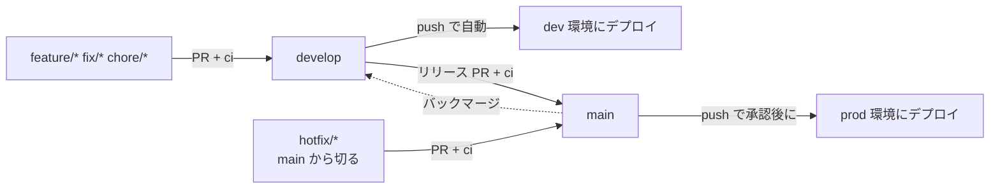

# 01. GitHub の利用フロー

## ブランチ

| ブランチ | 役割 | 保護 | デプロイ先 |
| --- | --- | --- | --- |
| `main` | **本番(prod)の写し**。main の内容 = prod にデプロイされているもの | あり(下記) | prod |
| `develop` | 開発の統合ブランチ。作業の起点 | なし(フェーズ 1 は直 push 可、フェーズ 2 は PR 経由) | dev |
| `feature/*` など | 個別の作業ブランチ。`develop` から切る | なし | なし(手動で dev へデプロイ可) |

- 基本は **`develop` を起点に作業ブランチを切り、PR を `develop` へマージ**する
- `develop` は保護しない。運用ルールとして直 push は行わない(必ず PR 経由)
- 本番へ出すときは、`develop` → `main` の PR を作ってマージする
- 上記は**開発が安定した後の運用**。それまでの運用は次の「運用フェーズ」を参照

## 運用フェーズ

ブランチ保護は**最後(開発が安定してから)に掛ける**。それまでは小回りを優先する。

| | フェーズ 1: 開発初期 | フェーズ 2: 安定後 |
| --- | --- | --- |
| `develop` への変更 | **直 push 可** | PR 経由のみ(運用ルール。保護はしない) |
| `main` の保護 | 掛けない | **掛ける**(下記「ブランチ保護」) |
| `main` への変更 | `develop` からのマージのみ(運用ルール) | `develop` → `main` の PR のみ。**他の人の Approve が必須** |
| レビュー | 不要 | 他の人が Approve する |
| CI | push 時に QA が走る(`deploy-to-dev`) | 同左 + PR で `ci` が必須 |

- フェーズ 2 への移行は、プロトタイプの機能が揃い、dev で安定して動くことを目安に判断する(移行時に保護を設定する)
- フェーズ 1 でも、`main` にマージされると prod へのデプロイ(承認待ち)が起動する。prod への反映は Environment `prod` の承認で止められる

## 作業ブランチ

| 接頭辞 | 用途 |
| --- | --- |
| `feature/` | 機能追加 |
| `fix/` | 不具合修正 |
| `chore/` | 設定・依存・ドキュメントなど |
| `hotfix/` | 本番の緊急修正(`main` から切る) |

- 例: `feature/scan-task`、`fix/jst-boundary`
- 作業ブランチは、マージ後に削除する

## 通常の開発フロー(フェーズ 2)

フェーズ 1 では、手順 1〜4 を省略して `develop` へ直接 push してよい(QA は push 後の `deploy-to-dev` で走る)。

1. `develop` を最新にして、作業ブランチを切る
2. 実装・設計ドキュメントの更新を行う(設計が変わる場合は `docs/engineering/` も同じ PR で更新)
3. `develop` へ PR を作る。`ci`(QA)が通ることを確認する
4. レビュー後、**squash merge** で `develop` へマージする
5. `develop` への push で dev 環境へ自動デプロイされる(QA とインテグレーションテストを含む)
6. dev で動作を確認する

## リリースフロー(prod)

フェーズ 1 では、手順 1〜3 の PR を省略し、`develop` から `main` へマージしてよい。

1. `develop` から `main` への PR を作る(リリース PR)
2. `ci` が通ることを確認し、レビューを受ける
3. **merge commit** で `main` へマージする(`main` と `develop` の履歴を揃え、差分が溜まらないようにする)
4. `main` への push で `deploy-to-prod` が起動する
5. GitHub の Environment `prod` の **Required reviewers の承認**後に、prod へデプロイされる
6. デプロイ後、prod の動作を確認する
7. `main` のマージコミットにバージョンタグを付け、リリースノートを書く(下記「リリースとバージョニング」)

## リリースとバージョニング

- `main` のコミットに**タグ**を付け、**リリースノート**を書く
- タグは `vMAJOR.MINOR.PATCH`(SemVer)。例: `v0.1.0`
- リリースノートは GitHub Releases に書く(「Generate release notes」で PR 一覧を生成し、変更点を人が補足する)
- タグは、prod へのデプロイが成功した `main` のコミットに付ける
- 付与は当面手動。自動化は後で検討する
- hotfix も同様に、マージ後にタグ(PATCH を上げる)とリリースノートを残す

## hotfix フロー(フェーズ 2)

1. `main` から `hotfix/*` を切って修正する
2. `main` へ PR を作り、`ci` と承認を経てマージする → prod へデプロイされる
3. 同じ修正を `develop` へバックマージする(`main` → `develop` の PR)

## ブランチ保護(`main`)

**フェーズ 2 に移行するときに設定する**(フェーズ 1 では掛けない)。GitHub の Settings(Rulesets を推奨)で設定する。リポジトリのコードには含まれない。

| 設定 | 値 |
| --- | --- |
| PR 必須(直 push 禁止) | 有効 |
| 必須ステータスチェック | `ci` の QA(`backend`、`terraform`) |
| ブランチを最新にしてからマージ | 有効 |
| 必要な承認数 | 1(**PR の作成者以外**の Approve) |
| 新しいコミットが push されたら承認を取り消す | 有効 |
| force push / 削除 | 禁止 |
| バイパス | なし(管理者にも適用) |

- Approve は**他の人**が行うことを必須とする。GitHub の仕様上、作成者は自分の PR を Approve できず、バイパスも設けないため、自己承認でのマージはできない
- 保護を掛ける前に、Approve できるメンバーを 2 人以上確保しておく(1 人だけだと `main` を更新できなくなる)
- hotfix も同じルールに従う

## デプロイとの対応

| 契機 | ワークフロー | 環境 |
| --- | --- | --- |
| PR(任意のブランチ) | `ci` | なし(QA のみ) |
| `develop` へ push | `deploy-to-dev`(QA → インフラ → アプリ) | dev |
| 手動(任意のブランチ) | `deploy-to-dev` | dev |
| `main` へ push | `deploy-to-prod`(QA → インフラ → アプリ) | prod(承認あり) |
| 手動(`main` のみ) | `deploy-to-prod` | prod(承認あり) |

- prod は Workload Identity の条件でも、`refs/heads/main` 以外からの認証を拒否する
- ワークフローの詳細は [../engineering/02-infra.md](../engineering/02-infra.md) の「CD」を参照

## インフラ(Terraform)の変更

- Terraform の変更も、通常のコードと同じ PR フローで扱う(`ci` で `fmt` / `validate` を検証)
- `apply` は GitHub Actions から実行する(D22)。`deploy-to-dev` / `deploy-to-prod` の中で、QA の後・アプリのデプロイの前に `reusable-infra-deploy` が走る
- 最初の `apply`(OIDC ができる前)だけは、担当者が手元で実行する
- prod の `plan` / `apply` は、Workload Identity の条件により `main` からのみ実行できる

## コミット・PR

- コミットメッセージは `type(scope): 内容` の形式(既存の履歴に合わせる)。日本語で書く
- PR には、変更の目的、確認方法、関連する設計ドキュメント・Open Question の ID を書く
- 1 つの PR は 1 つの目的に絞る
